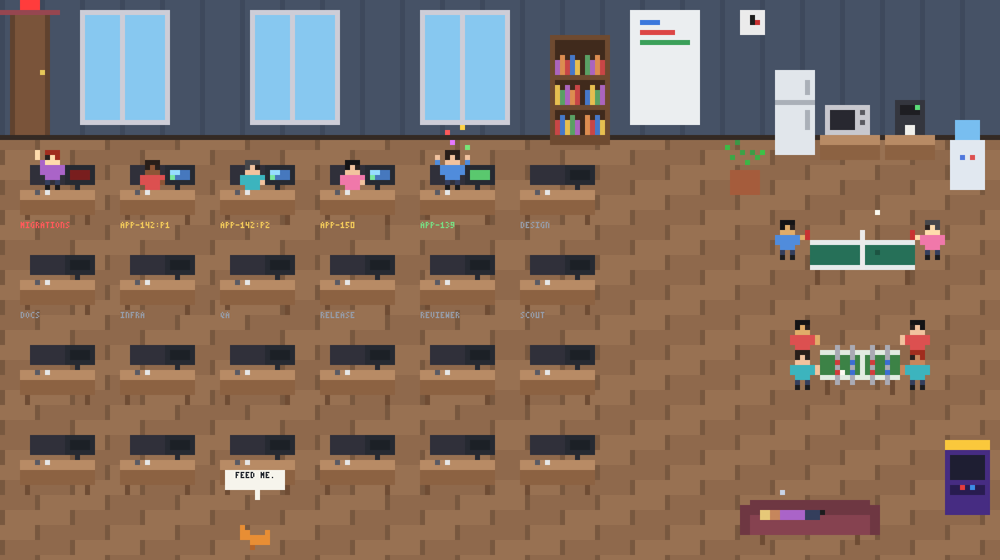
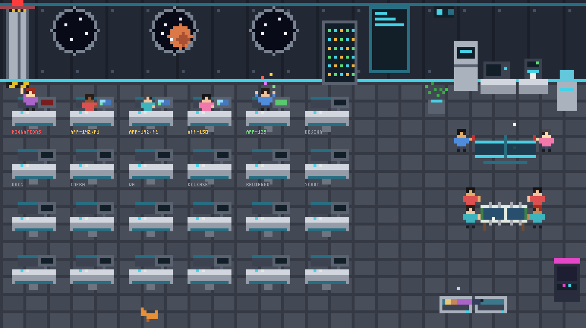
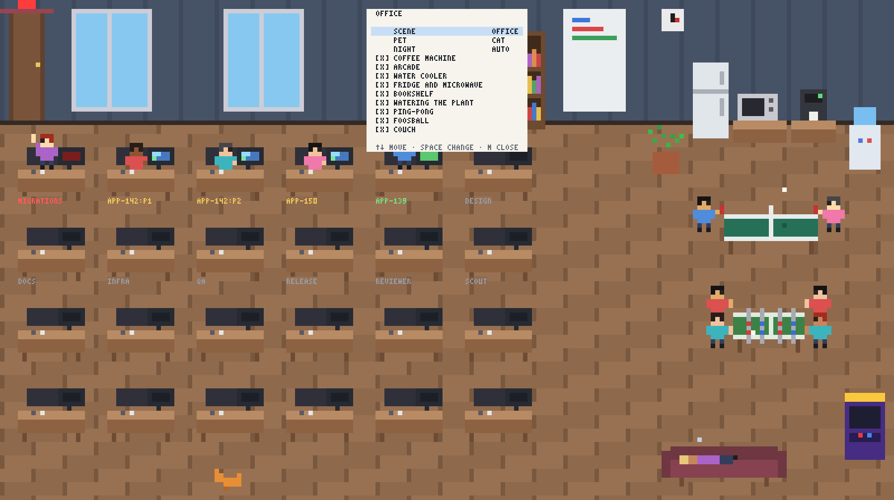
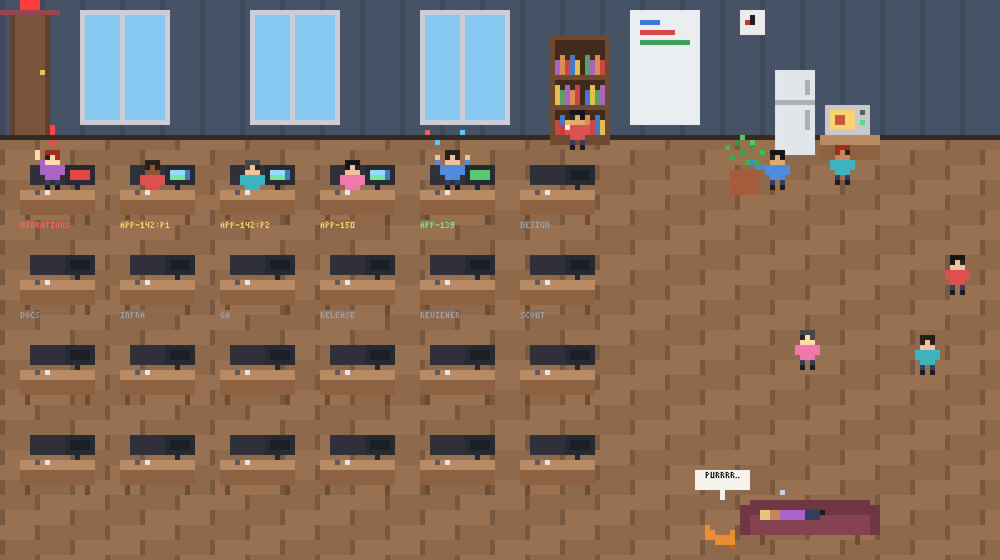
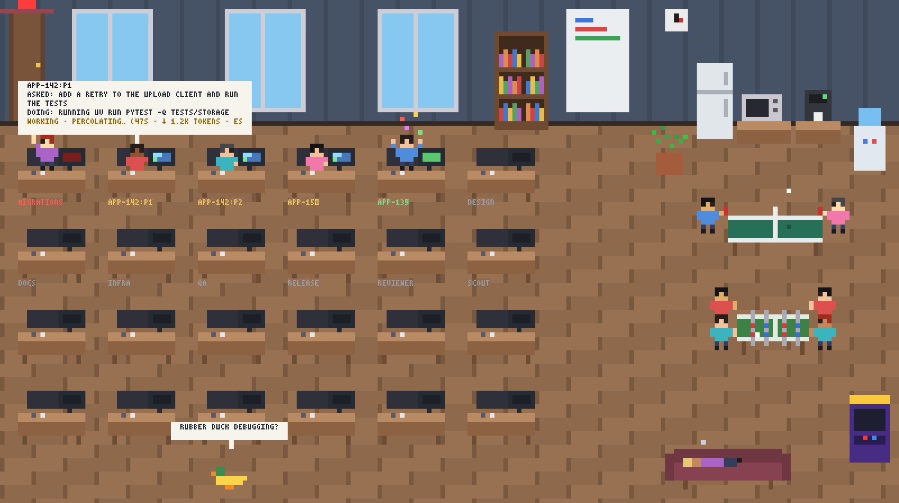
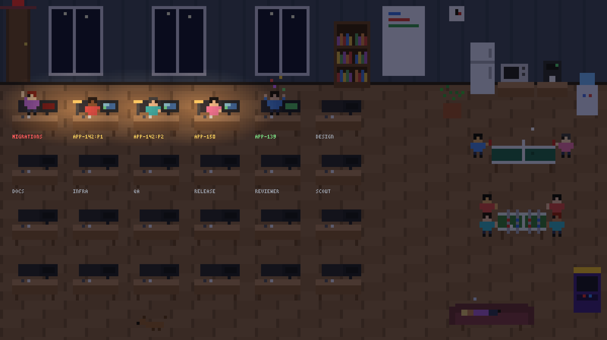

# herdr-office

A pixel-art office for your [herdr](https://herdr.dev) agents, drawn in the terminal with half-block characters.



Every agent herdr knows about is a person in the office:

- **working**: walks to their desk and types; the monitor scrolls code.
- **blocked**: stands at their desk with a hand up, and the alarm over the door flashes.
- **done**: spins their chair, then cheers in a shower of confetti until you look.
- **idle**: wanders the lounge, fetches coffee, hangs about the water cooler, heats lunch in the microwave, browses the bookshelf, waters the plant, plays the arcade (one at a time), ping-pong (in pairs) or foosball (four at once).
- **idle for 30 minutes**: naps on the couch.
- Agents whose labels share a ticket (say `app-142:p1` and `app-142:p2`) get up for a stand-up at the whiteboard now and then.
- New agents come in through the door with a balloon on their desk for their first day; agents that go away walk out.
- After 18:00 the room dims and working desks switch their lamps on.
- An office pet wanders along the bottom and says things.

Click someone to see what they were asked, what they are doing and any question waiting for you. Double-click to jump to their pane.

Press `m` for the menu: pick the scene, the pet and night mode, and switch any of the lounge's amenities off or on (switched-off furniture leaves the room). Choices are remembered.

Two scenes come with it: the **office**, and the **station**, the same floor plan aboard a space station with portholes onto space, consoles for desks, a coffee replicator, food synthesiser, data archive, hydroponics and sleep pods.








## Install

Needs Python 3.11 or newer (standard library only) and herdr 0.9 or newer.

From a local checkout:

```sh
herdr plugin link /path/to/herdr-office
```

From GitHub:

```sh
herdr plugin install Leeoc/herdr-office
```

Then run **office: open** from the command palette, which opens the office in a new tab of the current workspace.

## Controls

| Input | Does |
| --- | --- |
| `m` | menu: ↑↓ (or `j`/`k`) to move, space or enter to change, `m` or esc to close; items can be clicked too |
| click a person or their desk | speech bubble with their task, current step and status |
| double-click | jump to that agent's pane |
| click the pet | it says something |
| `p` | next pet (cat, dog, chicken, duck, none) |
| `n` | toggle night |
| `s` | save a PNG snapshot |

The same commands are herdr actions, so you can bind them to keys: **office: next pet**, **office: toggle night** and **office: snapshot to PNG** (which prints where it saved the picture). They reach every open office.

## Config

Put a `config.toml` in the plugin's config dir (`herdr plugin config-dir lee.herdr-office`). Every key is optional; `config.example.toml` lists them all.

| Key | Default | Meaning |
| --- | --- | --- |
| `pet` | `"cat"` | `cat`, `dog`, `chicken`, `duck`, `none`, or a pet you added |
| `scene` | `"office"` | `office`, `station`, or any module you add to `office/scenes` |
| `night` | `"auto"` | `auto` (18:00 to 07:00), `on` or `off` |
| `source` | `"events"` | `events` follows herdr's socket; `poll` asks the herdr CLI every 2 seconds |
| `nap_after_minutes` | `30` | idle this long and they nap |
| `closed` | `[]` | amenities switched off: any of `coffee`, `arcade`, `cooler`, `lunch`, `books`, `plant`, `pingpong`, `foosball`, `naps` |
| `ticket_pattern` | `(?i)\b([a-z]{2,}-\d+)` | labels with the same match hold stand-ups |
| `active_fps` | `10` | frame rate while anyone walks, cheers or plays |
| `still_fps` | `3` | frame rate otherwise |
| `[board]` | unset | `command`, `board` and `project` for an optional `board` CLI line in the click bubble |

What you pick in the menu is saved in the plugin's state dir (`choices.json`) and wins over `scene`, `pet`, `night` and `closed` here; delete that file to go back to the config. `--pet` and `OFFICE_PET` win over both.

The office draws nothing while its tab is not showing. Snapshots and the record of how long each agent has been in its state live in the plugin's state dir.

## Run it by hand

```sh
bin/office              # animate, reading herdr
bin/office --demo       # a scripted day, no herdr needed
bin/office --once       # print one frame and exit
bin/office --once --demo --png office.png
python3 -m unittest     # the tests
```

`OFFICE_HOUR=21` pretends it is 21:00.

## Add a pet

Pets are data. Put a JSON file in `pets/` under the plugin's config dir (or add to `data/pets.json`):

```json
{
  "frog": {
    "lines": ["Ribbit.", "*catches a bug*"],
    "colours": {"g": [90, 170, 70], "e": [20, 20, 20]},
    "origin": [0, -3],
    "frames": [
      [".ge.", "gggg", "g..g"],
      ["..ge", "gggg", ".gg."]
    ],
    "sequence": [[0, 4], [1, 4]]
  }
}
```

Frames are drawn facing right, one character per pixel, with `.` for clear. `origin` is where the top-left pixel sits relative to the pet's feet. `sequence` lists `[frame, ticks to hold it]`, at 10 ticks a second. People's colours come from `data/palette.json` the same way; a `palette.json` in the config dir replaces any of its lists.

## Add a scene

A scene is the place and how it looks. People never compute coordinates themselves: they ask the scene for places.

1. Create `office/scenes/<name>.py` with a subclass of `office.scenes.base.Scene` and end it with `SCENE = YourScene`.
2. Implement the places (`seat`, `desk_stand`, `entrance`, `nap_spot`, `meeting_spot`, `wander_spot`), what there is to do (`activities` for one person at a time, `games` for groups), the layout (`floor`, `obstacles`) and the drawing (`paint_background`, `paint_foreground`, `draw_person`, `lamps`, `person_at`, `pet_spot`).
3. It appears in the menu's Scene switcher straight away, or set `scene = "<name>"` in the config.

`office/scenes/office.py` is the worked example. To restyle the office rather than build a new floor plan, subclass `OfficeScene` and override its `paint_*` methods and `TITLES`, as `office/scenes/station.py` does. Walking routes come for free from `floor` and `obstacles`, and every activity and game you list shows up in the menu by its title.

## Add something to do

In a scene, an `Activity` is somewhere one person goes while idle (`name`, menu `title`, `spots` with one per person who fits, how long they stay, how often it is picked, and the `pose` to draw them in). A `Game` is played together on a timetable (`spots` and `facings` per player, how often and how long). Add one to the scene's list, draw it, and the people and the menu pick it up.

## Layout

```
bin/office            entrypoint; finds a Python 3.11+
office/people/        who people are and how they behave, knowing nothing about drawing
office/scenes/        the Scene interface and the office
office/sources/       where agent states come from: herdr's events, polling, or a scripted day
office/render/        canvas, lighting, terminal output, speech bubbles, PNG snapshots
office/details.py     what a Claude pane says it is doing, for the click bubble
office/menu.py        the settings panel
office/pathing.py     walking routes round furniture
data/                 pets and people's colours
```

## Licence

MIT
